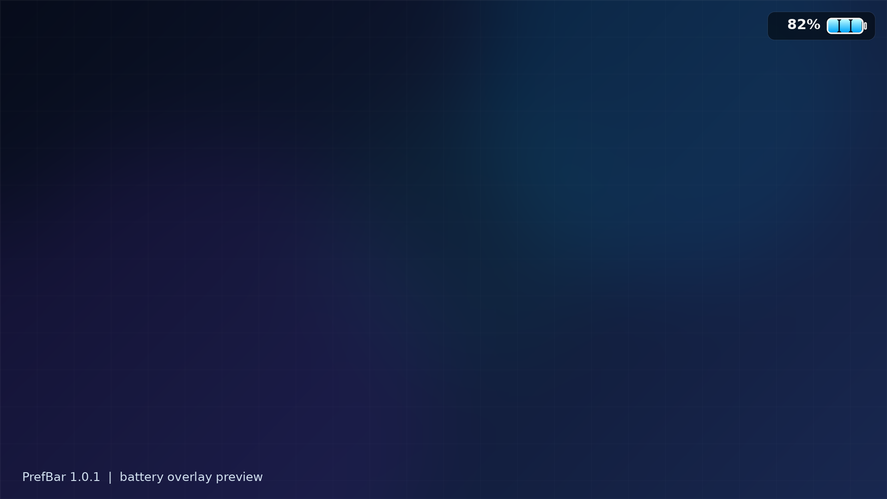
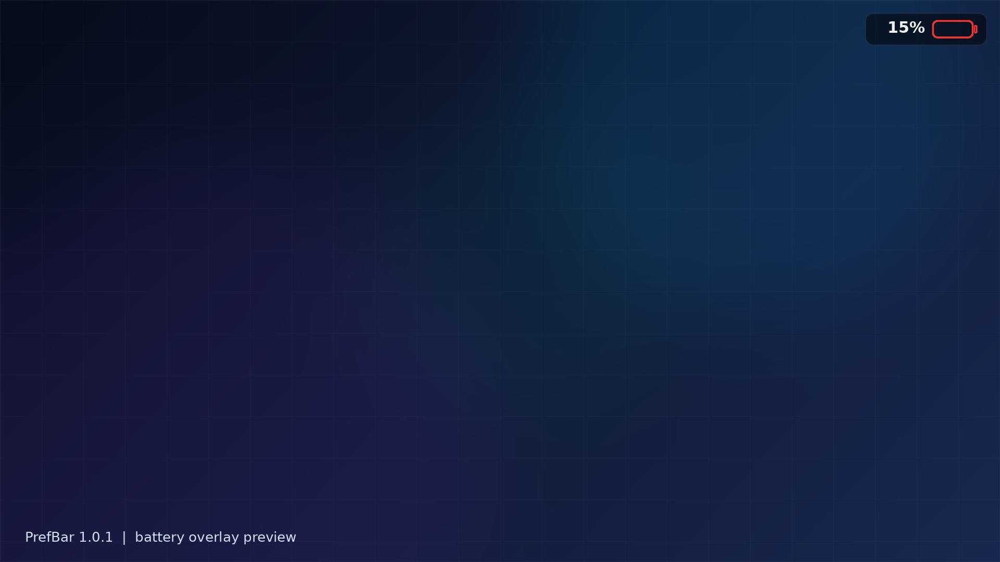

<p align="center">
  
</p>

[](https://github.com/VoxDon3/PrefBar/releases)

**Version 1.0.1**

PrefBar is a standalone on-screen battery overlay for jailbroken PlayStation 5 consoles. It reads the DualSense battery level and draws a compact battery panel over the running game, without requiring a separate renderer payload.




> These are preview images. The actual panel position and appearance depend on the game scene and firmware.

## Features

- **DualSense battery percentage:** Reads the controller battery level through `libSceHidControl`.
- **Three-segment gauge:** Neon-blue segments show the remaining charge at a glance.
- **Low-battery warning:** At 20% or lower, the normal battery body is replaced by a blinking red outline.
- **Standalone payload:** The controller and ShellUI renderer are packaged into one combined ELF.
- **On-demand module loading:** The controller loads `libSceHidControl.sprx` only when it is not already present.
- **Touchpad toggle:** Triple-click the DualSense touchpad to show or hide the overlay.
- **Local-only overlay:** No network connection is used by the renderer.

## How to use it

1. Download `PrefBar-complete_V1.0.1.elf` from [GitHub Releases](https://github.com/VoxDon3/PrefBar/releases/tag/v1.0.1).
2. Load the combined ELF on your jailbroken PS5 using your usual payload loader.
3. Start a game. PrefBar waits for ShellUI and the game process to be ready; allow a few seconds for initialization.
4. Triple-click the DualSense touchpad to toggle the battery overlay on or off.

## How it works

1. **Controller startup:** The combined ELF starts the controller, creates `/data/prefbar`, and starts the telemetry worker.
2. **Readiness gates:** The controller waits for stable ShellUI and game-process observations before touching ShellUI.
3. **Renderer injection:** The ShellUI renderer ELF is embedded inside the controller ELF. The controller injects it into SceShellUI and the renderer attaches to the PUI Mono UI.
4. **Battery polling:** Once per second, the renderer resolves the DualSense device ID with `scePadGetDeviceId`, then calls `sceHidControlGetBatteryState`. The battery state parser accepts 32-bit, 16-bit, and 8-bit field layouts used by different firmware versions.
5. **Drawing:** The panel, battery body, and segment textures are embedded in the ELF and written to `/Temp` or `/system_tmp` at runtime. PUI `ImageBox` widgets draw the panel and `Label` draws the percentage.
6. **Low-battery mode:** Above 20%, the blue segments show three bars above 66%, two bars above 33%, and one bar above 0%. At 20% or lower, the normal body is hidden and `body_red.png` blinks every 500 ms.
7. **Toggle path:** Three touchpad press edges within 1.5 seconds send a local control message to the controller, which flips the overlay visibility flag.

## Configuration and logs

The controller still creates `/data/prefbar/prefbar.conf`. Set `touchpad_toggle=0` to disable the triple-click toggle. The 1.0.1 battery renderer does not use the legacy performance text-color, font, or metric-row options.

Useful logs:

```text
/data/prefbar/controller.log
/data/prefbar/debug.log
/system_tmp/prefbar_shellui.log
```

## Build from source

Want to compile PrefBar yourself? See the [build guide](Docs/BUILD.md) for the PS5 Payload SDK requirements, build commands, output files, optional host tests, and cleanup instructions.

For architecture details and the legacy telemetry pipeline, see [HOW_IT_WORKS.md](Docs/HOW_IT_WORKS.md).

## Support

PrefBar is free software under GPL-3.0 and will stay free. If it's useful to you, voluntary tips are appreciated, no strings attached.

| Network | Address |
|---|---|
| BTC | `bc1qse9aacl20l2kewxkr529nxvjrsnulz6x9vxf43` |
| ETH / USDC (ERC-20) | `0x5De60ca53aE6Dbd8C8B9a99a578519244D264ee0` |
| BNB (BEP-20) | `0x5De60ca53aE6Dbd8C8B9a99a578519244D264ee0` |
| SOL | `2qJYqm3pnX1jFtcG5zKtoh8KTuXE7iqqwNxCLFy2oFk3` |
| TRX (TRC-20) | `TC5BpBP4P8AcXqvYC7RtWyXfL6Xx1QR5ph` |

## Credits and license

**License:** GPL-3.0

For full credits, attribution, and source provenance, see [CREDITS.md](Docs/CREDITS.md).

**Disclaimer:** PrefBar is unofficial homebrew. Use it at your own risk.
